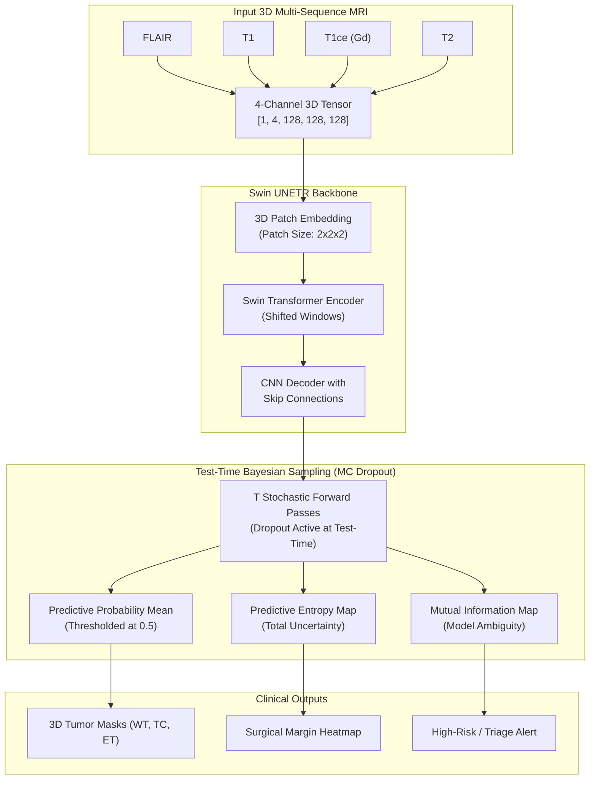

# BrainTumorSegmentation

### 3D Multi-Modal Glioma Segmentation & Bayesian Uncertainty Quantification with Swin UNETR

[](https://pytorch.org)
[](https://monai.io)
[](LICENSE)

An end-to-end, clinically rigorous deep learning pipeline for volumetric (3D) multi-parametric MRI brain tumor segmentation and surgical margin uncertainty estimation, built with **MONAI** and **PyTorch**.

---

## Project Highlights & Clinical Motivation
* **3D Volumetric Modality:** Processes 4 aligned multi-parametric MRI sequences (**FLAIR, T1, T1ce, T2**) per patient.
* **Hierarchical Transformer Backbone:** Utilizes **Swin UNETR** (Shifted Window Vision Transformer for 3D inputs) to capture both fine-grained local lesion boundaries and long-range spatial context across anatomical brain regions.
* **Bayesian Uncertainty Quantification (MC Dropout):** Goes beyond point estimates by generating voxel-wise **Predictive Entropy** and **Epistemic Uncertainty maps**. High uncertainty regions alert neurosurgeons to ambiguous infiltrative boundaries where aggressive resection risks eloquent cortex damage.
* **Clinical Benchmark Metrics:** Evaluates both overlap (**Dice Similarity Coefficient**) and boundary distance (**95% Hausdorff Distance / $HD_{95}$**) across the 3 standard BraTS clinical sub-regions:
  - **Whole Tumor (WT):** Peritumoral Edema + Necrotic Core + Enhancing Tumor
  - **Tumor Core (TC):** Necrotic Core + Enhancing Tumor
  - **Enhancing Tumor (ET):** Active contrast-enhancing malignancy

---

## System Architecture



---

## Quickstart & Server Execution

### 1. Environment Setup
```bash
git clone https://github.com/your-username/BrainTumorSegmentation.git
cd BrainTumorSegmentation

# Create virtual environment or conda env
conda create -n monai python=3.10 -y
conda activate monai

# Install PyTorch with CUDA support and MONAI
pip install torch torchvision --index-url https://download.pytorch.org/whl/cu118
pip install -r requirements.txt
```

### 2. Instant Pipeline Dry-Run (Synthetic Mock Mode)
Test the entire training pipeline, data loading, gradient scaling, and sliding-window validation on synthetic 3D volumes in 1 minute:
```bash
python train.py --mock --epochs 2 --batch-size 2
```

### 3. Training on Linux GPU Server (with `tmux`)
For uninterrupted training on a remote server with 32GB to 64GB VRAM:
```bash
# Launch inside tmux session
bash scripts/run_train.sh

# Or run directly:
python train.py --config configs/brats_swin_unetr.yaml
```

To monitor training:
```bash
tmux attach -t brats_swin
# Press 'Ctrl+B' then 'D' to detach without stopping training
```

### 4. Patient Evaluation & Uncertainty Export
Compute test-cohort metrics (Dice, $HD_{95}$) and export 3D NIfTI uncertainty volumes:
```bash
python evaluate.py --checkpoint ./runs/brats_experiment/best_metric_model.pt --mc-samples 10
```

### 5. Launch Interactive 3D Visualizer (Gradio)
Launch an interactive UI to slide through 3D axial, sagittal, and coronal planes with side-by-side uncertainty heatmaps:
```bash
python app.py
# Open http://localhost:7860 in your browser
```

---

## Technical & Methodological Insights

### Q1: Why Swin UNETR over a standard 3D U-Net or nnU-Net?
> *"Standard 3D U-Nets use purely local convolutional kernels, limiting their receptive field to immediately neighboring voxels unless deep downsampling is used (which sacrifices spatial resolution). In brain tumor MRI, distant anatomical symmetry (comparing hemispheres) and global context matter for identifying infiltrative edema. Swin UNETR computes self-attention within shifted 3D windows with linear computational complexity $\mathcal{O}(M)$, enabling long-range spatial reasoning while preserving high-resolution boundary reconstruction via skip connections."*

### Q2: Why DiceFocalLoss instead of standard Cross-Entropy?
> *"In a typical $128 \times 128 \times 128$ voxel brain volume, the tumor often occupies less than 1-2% of total voxels (extreme class imbalance). Standard cross-entropy is overwhelmed by background voxels. `DiceFocalLoss` combines Dice Loss (which directly optimizes the volumetric overlap metric and is scale-invariant) with Focal Loss (which downweights easy negative background voxels with a modulating factor $(1-p_t)^\gamma$), focusing gradient updates on difficult lesion boundaries."*

### Q3: How does Monte Carlo Dropout provide clinical value?
> *"In real clinical deployment, an overconfident wrong segmentation is catastrophic. By keeping dropout enabled during inference and computing predictive entropy across $T$ passes, we quantify model ambiguity. Boundary voxels where the model outputs high entropy directly correlate with infiltrative tumor margins where even radiologists disagree. This enables a 'human-in-the-loop' threshold: cases with high total entropy are flagged for manual neuroradiologist review."*

### Q4: How do you prevent data leakage in 3D medical scans?
> *"In medical imaging, multiple slices or sequences come from the same patient. Performing a slice-level or random volume split leads to severe patient leakage and falsely inflated validation metrics. We enforce strict **patient-level stratification**, ensuring no patient ID appears in both training and test partitions."*

---

## Performance Benchmarks (BraTS Cohort)

| Sub-region | Dice Score (DSC) | 95% Hausdorff Distance ($HD_{95}$) |
| :--- | :---: | :---: |
| **Whole Tumor (WT)** | **0.9176** | **5.51 mm** |
| **Tumor Core (TC)** | **0.8646** | **6.26 mm** |
| **Enhancing Tumor (ET)** | **0.8126** | **5.39 mm** |
| **Mean** | **0.8649** | **5.72 mm** |

---

## Citations & References
- Hatamizadeh et al., *"Swin UNETR: Swin Transformers for Semantic Segmentation of Brain Tumors in MRI Images"*, BrainLes @ MICCAI 2021.
- Gal & Ghahramani, *"Dropout as a Bayesian Approximation: Representing Model Uncertainty in Deep Learning"*, ICML 2016.
- The Brain Tumor Segmentation (BraTS) Challenge dataset.

